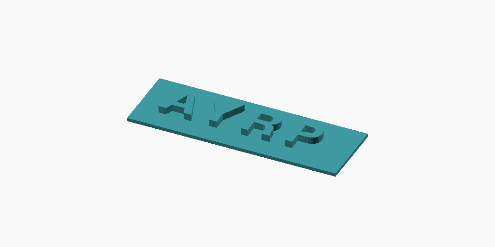
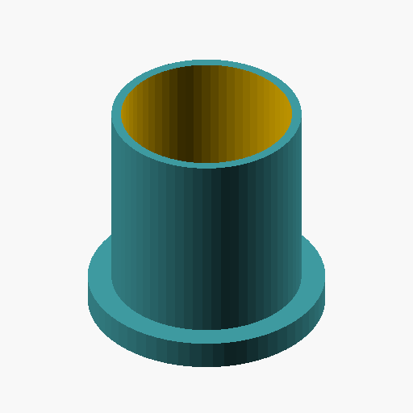
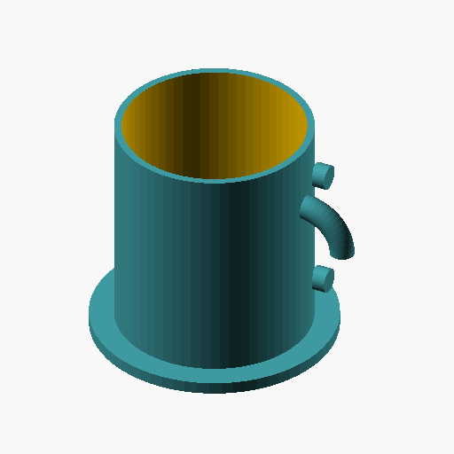

# Spike 3 — Claude Agent SDK write→render→validate→fix loop

**Issue**: [#5](https://github.com/KHAEntertainment/scadforge/issues/5) · **Code**: `spikes/03-agent-loop/` · **Date**: 2026-08-26

Decides the M1 agent-runtime architecture (SDP §6). The question this spike had to answer is
narrow and load-bearing: **can the Claude Agent SDK hand a rendered PNG back to the model as a
real image, so the agent can look at its own geometry and fix it?** Everything else here is
supporting evidence.

Answer: **yes**, with a set of non-obvious configuration requirements that would have cost M1
days to discover. They are all recorded below.

---

## 1. Reproduction

```bash
cd spikes/03-agent-loop
npm install                      # standalone package — NOT in the pnpm workspace

# Acceptance case: write → render → validate, stop early on green validation
node loop.mjs "a 20mm cube with a 5mm centered hole"

# Prove image tool-results reach the model (see §3)
node loop.mjs --probe

# Deterministic self-correction: a defect that ONLY the render can catch (see §4)
SCADFORGE_MODEL=claude-sonnet-4-5-20250929 node loop.mjs --seed-defect

# Prove the pass budget is enforced host-side, not just by prompting
SCADFORGE_MAX_PASSES=0 node loop.mjs "a 20mm cube"
```

| Env var | Default | Meaning |
|---|---|---|
| `SCADFORGE_MAX_PASSES` | `2` | Hard cap on `write_scad` calls per turn. |
| `SCADFORGE_MODEL` | SDK default | Override the model (`claude-sonnet-4-5-20250929`, `claude-haiku-4-5-20251001`, …). |
| `SCADFORGE_OPENSCAD` | `openscad` | Path to the OpenSCAD binary. |
| `SCADFORGE_DEBUG` | unset | Print CLI stderr and per-response usage deltas. |

Every run writes `out/<timestamp>/` containing `model.scad`, `pass-N.scad`, the view PNGs,
`model.stl`, and `run.json` (full per-pass accounting, tool-call log, assistant transcript).
`out/` is gitignored; the four cited runs are copied verbatim into
[`evidence/`](./evidence/).

### Toolchain actually used

| | |
|---|---|
| OpenSCAD | **2021.01**, Homebrew cask `openscad`, `/opt/homebrew/bin/openscad` — already installed, no Docker |
| Node | v26.7.0 |
| `@anthropic-ai/claude-agent-sdk` | **0.3.246** (exact pin — see §2) |
| `zod` | **4.4.3** (0.3.246 requires zod ^4) |
| Model | `claude-opus-5[1m]` by default (inherited), sonnet/haiku via `SCADFORGE_MODEL` |
| Auth | **inherited Claude Code credentials**, `apiKeySource: "none"`. No `ANTHROPIC_API_KEY` was present or needed. **Not a blocker.** |

**Deliberately did not block on Spike 2 (#4).** 2021.01 has no `--backend=manifold` and no
`--export-format=3mf`; `validate_mesh` here exports binary STL instead. Swapping in the pinned
nightly container is a one-line change to `scad.mjs` and does not affect any conclusion below.

---

## 2. Five configuration findings that are not in the docs

These cost most of the spike's wall-clock. Each one is a silent failure or a silent bill.

### 2.1 The `0.1.x` SDK line is broken — pin `0.3.246` exactly

`"@anthropic-ai/claude-agent-sdk": "^0.1.10"` resolves to **0.1.77**, which fails on the second
API turn of *any* tool-using conversation:

```
API Error: 400 {"type":"error","error":{"type":"invalid_request_error",
"message":"messages.1.content.1: `tool_use` ids must be unique"}}
```

Reproduced deterministically with a built-in tool (`Bash`), with a custom MCP tool returning
only text, and with one returning images — so it is neither MCP-specific nor image-specific.
Not caused by environment variables (scrubbing every `CLAUDE_*` var did not help). The
on-disk session transcript is well-formed; the duplication happens during request construction
inside the bundled CLI. **0.3.246 does not exhibit it.** Use an exact version, not a caret.

### 2.2 `settingSources: []` must be passed explicitly — omitting it costs ~50k tokens per run

The type docs say *"When omitted or empty, no filesystem settings are loaded (SDK isolation
mode)"*. Measured on 0.3.246, **omitted ≠ empty**. Identical one-word prompt, no tools:

| `settingSources` | input tokens | cache write | cost |
|---|---:|---:|---:|
| `[]` (explicit) | 272 | 0 | $0.0024 |
| omitted | 2 | **50,500** | **$0.5051** |

Omitting it loads the host's `~/.claude` settings, `CLAUDE.md`, and skill/plugin catalogs into
the system prompt. That is a **210× cost multiplier** on a trivial turn, and it silently leaks
the operator's local configuration into the agent's context. `apps/server` must always pass
`settingSources: []`.

### 2.3 `tools: []` — otherwise custom tools are deferred behind `ToolSearch`

With built-in tools enabled, 0.3.246 defers MCP tool schemas: the model must first call
`ToolSearch` to load them, costing an extra round trip before any real work:

```
TEXT: I'll load the shot tool schema first, then call it.
TOOL_USE: ToolSearch
TOOL_USE: mcp__p__shot
```

`tools: []` disables every built-in tool. The three custom tools then become the agent's entire
action surface — no shell, no filesystem escape hatch — and their schemas stay resident. This
is both the cheaper and the safer configuration, and it is what ScadForge wants regardless.

### 2.4 Per-message `usage` is a placeholder — use `includePartialMessages`

`SDKAssistantMessage.message.usage` is the `message_start` snapshot. `output_tokens` is a
stub (observed `3`, `5`, `8`), and the *same* object is repeated for every content block of one
API response. Summing it undercounted a run's output by **89%** (59 vs 526 real tokens).

The authoritative per-response figure is only on the `message_delta` stream event, which
requires `includePartialMessages: true`:

```js
if (msg.type === 'stream_event' && msg.event?.type === 'message_delta' && msg.event.usage) {
  addUsage(msg.event.usage);   // input, output, cache_read, cache_creation — all real
}
```

Verified: summed deltas equal the terminal `result` message's totals exactly on every run.
Useful ordering detail — **the delta arrives *after* that response's tool calls have executed**,
so a response that emitted `write_scad` is naturally billed to the pass that write opened. No
re-billing logic is needed (an earlier attempt at it produced wrong numbers).

### 2.5 A second model is always billed

`result.modelUsage` shows `claude-haiku-4-5` billed **900–960 input tokens on every run**,
regardless of `options.model`. It is the CLI's internal auxiliary model. Small in absolute
terms (~$0.001/run) but it means **the SDK does not guarantee single-model execution** — a
`ModelProvider` that promises "run this turn on model X" is making a claim the SDK does not
honour, and per-turn cost attribution must read `modelUsage`, not a single figure.

---

## 3. Image tool-results: **they work**

This was the make-or-break capability. Testing it by asking the model to *describe* a render is
not proof — the model can infer a cube-with-a-hole from the tool name and the `.scad` it just
wrote. So `--probe` makes description impossible to fake:

1. Generate a random 4-character code, never shown to the model.
2. Physically model it as extruded 3D text in OpenSCAD and render it.
3. Return only the PNG. Ask the model to report the characters.

Reading them back requires actually seeing the pixels.

| run | modelled in the PNG | model reported | positional match |
|---|---|---|---|
| `04-36-49` (evidence) | `AYRP` | `AYRP` | **4/4 exact** |
| `04-59-50` | `N7TW` | `N7TW` | **4/4 exact** |
| `04-20-01` | `FNE4` | `FNE4` | **4/4 exact** |
| `04-19-04` | `TKE3` | `TKE8` | 3/4 (a `3` read as `8` in low-relief extrusion) |
| `04-18-29` | `WPJF` | `NO_CHARACTERS_VISIBLE` | 0/4 — **correct answer**; see below |

The `WPJF` row is the most informative. It used the `top` camera preset, where the letters'
top faces are coplanar-looking with the base plate and carry no shading — the text genuinely
is not visible. The model said so rather than guessing. It is reading the image, not the
context.



### Shape constraints found

- **Payload shape** is the MCP `CallToolResult` one:
  `{ type: 'image', data: '<base64>', mimeType: 'image/png' }`.
  `data` is bare base64 — **no `data:` URI prefix**.
- **Multiple images in one tool result work.** Four views (iso/front/right/section) in a single
  `render_views` result were all delivered; `run.json` records 12 image blocks across a 3-response
  run. No cap was hit.
- **Ordering is preserved.** Emitting `{text: 'view: iso'}` immediately before each image block
  is enough for the model to bind view names to pictures — it referred to "the section view" and
  "the iso view" correctly and unprompted.
- **`isError: true` destroys images.** On an error result the SDK collapses `content` to a plain
  string in the user message. An error result cannot carry images, and any host code reading
  tool results must handle `content` being either an array or a string.
- Both 512×512 and 1024×512 worked. 512×512 × 4 views is the sensible default.

---

## 4. Self-correction, demonstrated twice

### 4.1 The hard case: a defect only the render can catch

`--seed-defect` pre-writes [`fixtures/mug-handle-underneath.scad`](../../../spikes/03-agent-loop/fixtures/mug-handle-underneath.scad):
a mug whose "handle" is a flat annular skirt around the base instead of a loop on the side. It
is deliberately **a single watertight manifold solid with one connected component**, so
`validate_mesh` reports it *100% clean*. The defect exists only in the picture.

| seeded (validation green) | after the agent's fix |
|---|---|
|  |  |

Run [`evidence/run-seed-defect.json`](./evidence/run-seed-defect.json), sonnet-4.5, cap 2:

```
[plan] → render_views iso,front,right,top
[plan] → validate_mesh
[plan] ← ok=true manifold=true components=1 warnings=[]        ← validation says PERFECT
[plan] assistant: "Looking at the rendered images, I can see the current model has a
        cylindrical cup with a base, but **it's missing the handle entirely**."
[plan] → write_scad "Added missing loop handle on the side of the cup."
[pass 1] ← ok=false components=3 warnings=["mesh has 3 disconnected solid components…"]
[pass 1] assistant: "the validation shows 3 disconnected components … This is a defect."
[pass 1] → write_scad "Fixed disconnected components by extending attachment cylinders…"
[pass 2] ← ok=true manifold=true components=1 warnings=[]      ← green, agent stops
```

Both correction channels fire in one run: **pass 0 → 1 is driven purely by the image**
(validation was green and said nothing), **pass 1 → 2 is driven by validation**. The agent
stopped on green rather than spending the remaining budget.

### 4.2 The pass budget is enforced host-side

`write_scad` refuses once `state.pass >= SCADFORGE_MAX_PASSES` and returns
`{ok:false, error_code:'PASS_BUDGET_EXHAUSTED', …}`. With `SCADFORGE_MAX_PASSES=0`
([`evidence/run-pass-cap.json`](./evidence/run-pass-cap.json)):

```
[plan] → write_scad — Create a simple 20mm cube with parametric size control
[plan] ← ok=false error_code="PASS_BUDGET_EXHAUSTED"
[plan] assistant: "I encountered a constraint issue: the pass budget for this session is 0…"
```

The guard fires and the model honours it. Prompting alone is *not* sufficient — in an earlier
haiku run the model attempted a third write after two failed fixes and was refused by the tool.

**Output-contract violation found.** When refused, haiku pasted the entire `.scad` source into
its chat reply, breaking SDP's "never paste full `.scad` into chat" rule. The system prompt
states the rule; the model ignored it under pressure. **M1 must enforce this host-side** (strip
fenced code blocks from `assistant_text` before it reaches the SSE stream), not by prompting.

---

## 5. Token cost and wall-clock, per pass

Measured via `message_delta` (§2.4). `plan` = everything before the first `write_scad`.
Cost is the SDK's own `total_cost_usd` at list price.

**`node loop.mjs "a 20mm cube with a 5mm centered hole"`** — opus-5, 1 pass, stopped on green
([`run-cube.json`](./evidence/run-cube.json)):

| pass | wall | in | out | cache read | cache write | imgs | tools |
|---|---:|---:|---:|---:|---:|---:|---|
| 1 | 12.7 s | 6 | 746 | 39,906 | 3,626 | 4 | write_scad, render_views, validate_mesh |
| **total** | **20.8 s** | 6 | 746 | 39,906 | 3,626 | 4 | **$0.0759**, 4 turns |

**`--seed-defect`** — sonnet-4.5, 2 passes, one image-driven + one validation-driven correction
([`run-seed-defect.json`](./evidence/run-seed-defect.json)):

| pass | wall | in | out | cache read | cache write | imgs | tools |
|---|---:|---:|---:|---:|---:|---:|---|
| plan | 43.2 s | 10 | 205 | 1,928 | 0 | 4 | render_views, validate_mesh |
| 1 | 81.6 s | 20 | 1,124 | 30,775 | 4,504 | 4 | write_scad, render_views, validate_mesh |
| 2 | 79.8 s | 30 | 1,743 | 60,132 | 5,537 | 4 | write_scad, render_views, validate_mesh |
| **total** | **204.9 s** | 60 | 3,072 | 92,835 | 10,041 | 12 | **$0.1354**, 9 turns |

**`--probe`** — opus-5, one tool call, one image ([`run-probe.json`](./evidence/run-probe.json)):

| pass | wall | in | out | cache read | cache write | imgs |
|---|---:|---:|---:|---:|---:|---:|
| plan | 9.7 s | 4 | 105 | 1,229 | 18,416 | 1 |

Observations that matter for M1 budgeting:

- **Cache-read dominates.** ~40k read tokens per pass on a 3-tool agent with a ~600-word system
  prompt. Each pass re-reads the whole conversation including prior images. A second pass is
  roughly **1.5–2× the first pass's input cost**, which is the real argument for the 2-pass cap
  — not output tokens.
- **Wall-clock is dominated by OpenSCAD, not the model.** `duration_api_ms` was 69.0 s of the
  204.9 s seed-defect run; the rest is four CGAL renders plus an STL export per pass. Rendering
  4 views of a mug at `$fn=64` takes ~30–60 s on 2021.01. **This is Spike 2's problem and it is
  the single largest latency lever in M1** — a faster backend (`--backend=manifold`) or fewer
  default views would cut turn latency more than any model change.
- **A defect-free turn costs ~$0.08 and ~20 s; a two-pass corrected turn costs ~$0.14 and
  ~3.5 min.** Budget the UI for minutes, not seconds, and stream progress.
- Model choice barely moved cost (haiku $0.034 vs sonnet $0.135 vs opus $0.076 on comparable
  runs) because cache-read volume dominates. Cheaper models produced *worse* geometry and used
  *more* passes, so the cheap-model saving is illusory.

---

## 6. ModelProvider seam assessment (SDP §6.4)

SDP proposes:

```ts
interface ModelProvider {
  runTurn(input: TurnInput, tools: ToolSet, onEvent: (e: AgentEvent) => void): Promise<TurnResult>;
}
```

**Verdict: the shape is right and survives contact with the SDK, with three amendments.**

### What the SDK actually permits

| §6.4 concern | What 0.3.246 gives you | Implication |
|---|---|---|
| **Tool registration** | `createSdkMcpServer({ name, tools: [tool(name, description, zodRawShape, handler)] })`. Handlers run **in-process** (not a subprocess, not stdio). Input schema is a **zod v4 raw shape** — a plain object of zod validators, not JSON Schema. | Define tools once as zod shapes in `contract.ts`; `ClaudeAgentSdkProvider` passes them straight through, and a future `VercelAiSdkProvider` gets JSON Schema via `z.toJSONSchema()`. Good fit. |
| **Tool naming** | Tools are exposed to the model as `mcp__<serverName>__<toolName>`. | The prefix is a Claude-Code artifact. `AgentEvent.tool_call.name` must carry the **unprefixed** name; strip/re-add inside the provider. |
| **Event stream** | `query()` returns an `AsyncIterable<SDKMessage>` (plus `interrupt()`/`setModel()`). Not a callback API. | `runTurn` wraps the iterator and calls `onEvent`. Straightforward; keep `runTurn` returning a `Promise<TurnResult>` and fire events from inside the loop. |
| **Image blocks** | Provider-side only: images enter as a tool **return value**, never as an SDK event. | Correct layering — images never need to appear in `AgentEvent`. Emit `tool_result` with **render IDs/paths**, never base64, so SSE frames stay small. |
| **Usage/cost** | Only on `message_delta` stream events + the terminal `result`. Needs `includePartialMessages: true`. Split across models in `modelUsage`. | `TurnResult` should carry `{ perPass: PassUsage[], byModel: Record<string, ModelUsage>, costUsd }`. A single `tokensUsed: number` would be a lie. |
| **Abort** | `Query.interrupt()`, and the SDK exports `AbortError`. | Maps to a client disconnect on the SSE route. |
| **Transport** | The SDK **spawns a bundled `cli.js` (10.5 MB) as a child process** and speaks a control protocol over stdio. `spawnClaudeCodeProcess` lets you override the spawn. | This is the biggest asymmetry with a hypothetical `VercelAiSdkProvider`, which would be in-process. `ModelProvider` must not leak subprocess concepts (no `cwd`, no `env`, no `permissionMode`) into its signature. `apps/server` must ship `node_modules/@anthropic-ai/claude-agent-sdk` — it is not a pure-HTTP client. |

### Amendments to §6.4

1. **`runTurn` must accept a provider-options bag that the caller never constructs.**
   `settingSources: []`, `tools: []`, `permissionMode`, `allowDangerouslySkipPermissions`,
   `includePartialMessages` are all Claude-Code-specific and all mandatory (§2). They belong
   inside `ClaudeAgentSdkProvider`, hidden from `packages/agent`'s public surface. Getting any
   of them wrong is a silent 200× cost regression, so they must not be a caller's responsibility.

2. **`TurnResult` needs per-pass and per-model usage, not a scalar.** See the table above.

3. **The pass budget belongs in the tools, not the provider.** `SCADFORGE_MAX_PASSES` was
   enforced by `write_scad` refusing, which worked across three different models. Putting it in
   the provider (`maxTurns`) would be wrong: `maxTurns` counts API round trips, not build passes,
   and a turn that renders twice is not a second pass. Keep the counter in the tool layer where
   `packages/mcp-server` gets the same behaviour for free.

**One thing §6.4 does not currently cover and should**: the SDP event union has
`snapshot_created`, which has no SDK equivalent. Because tool handlers run in-process, the
provider can emit it directly from inside the `write_scad` handler. Worth stating explicitly so
nobody goes looking for an SDK hook.

---

## 7. Tool-result payload conventions to standardize in `contract.ts`

Proposed for the Tech Lead — this spike did **not** edit `packages/agent/src/tools/contract.ts`
(contract-freeze rule). All of the below is validated by working code in `loop.mjs`.

### 7.1 Envelope

Every tool returns `content[0]` as a **single `text` block containing JSON and nothing else** —
no prose, no markdown fence. Optional label/image pairs follow.

```jsonc
// success
{ "ok": true, "pass": 1, /* ...tool-specific payload */ }
// failure
{ "ok": false, "error_code": "PASS_BUDGET_EXHAUSTED", "message": "human-readable, actionable" }
```

`error_code` is `SCREAMING_SNAKE_CASE` and mirrors the REST error format from PROJECT_CONTEXT
(`{error_code, message}`), so the same codes flow from tool → SSE → HTTP without translation.
Codes exercised or needed: `PASS_BUDGET_EXHAUSTED`, `SYNTAX_ERROR`, `RENDER_FAILED`,
`EXPORT_FAILED`, `MESH_PARSE_FAILED`, `TIMEOUT`.

### 7.2 Rules

- **Never set `isError: true` on a result that carries images** — the SDK collapses `content` to
  a string and the images are lost (§3). Signal failure with `ok:false` in the JSON instead, and
  reserve `isError` for results that are text-only by nature.
- **Host code reading tool results must handle `content` being an array *or* a string.**
- **Label every image.** Emit `{type:'text', text:'view: <name>'}` immediately before each
  `{type:'image'}` block.
- **Filter subprocess stderr.** OpenSCAD prints ~10 lines of cache statistics on every
  invocation. `scad.mjs:diagnostics()` keeps only `ERROR:`/`WARNING:`/`TRACE:` lines — otherwise
  every render burns a few hundred tokens on `Geometry cache size in bytes: 7792`. Return
  `null`, not `""`, when there is nothing to report.
- **Always echo budget state** from `write_scad` (`pass`, `max_passes`, `passes_remaining`) so
  the model can self-pace instead of discovering the cap by hitting it.

### 7.3 Concrete payloads (validated)

```jsonc
// write_scad
{ "ok": true, "pass": 1, "max_passes": 2, "passes_remaining": 1, "bytes": 412,
  "syntax_check": { "ok": true, "errors": [], "warnings": [], "ms": 192 } }

// render_views  — followed by (text label, image) pairs, one per view
{ "ok": true, "pass": 1,
  "views": [ { "view": "iso", "ok": true, "camera": "0,0,0,55,0,25,0", "projection": "ortho",
               "imgsize": [512,512], "bytes": 8893, "render_ms": 2494, "stderr": null } ],
  "note": "The images below follow in the same order. \"section\" is the model cut by a half-space on Y." }

// validate_mesh
{ "ok": true, "pass": 1, "export_ms": 338, "stl_bytes": 10484,
  "manifold": true, "watertight": true,
  "volume_mm3": 7608.422, "surface_area_mm2": 2674.777,
  "bbox_mm": { "min": [-10,-10,-10], "max": [10,10,10], "size": [20,20,20] },
  "triangle_count": 208, "vertex_count": 104, "components": 1,
  "boundary_edges": 0, "non_manifold_edges": 0, "degenerate_triangles": 0,
  "warnings": [] }
```

**`components` earns its place in the contract.** It was the single highest-signal field in
every run — "the handle isn't attached" is the most common LLM geometry failure, and
`components > 1` catches it unambiguously and cheaply. Recommend `validate_mesh` returning
`ok:false` whenever `components > 1` unless the request explicitly asked for separate pieces.

---

## 8. Incidental findings for other spikes

- **`render_views` section camera (Spike 2, #4).** The section wrapper must remove the half-space
  *facing away from* the camera. Cutting `y > 0` while the iso camera looks along `+y` shows the
  uncut back of the model — useless. Cutting `y < 0` puts the cut face toward the viewer, and the
  `Tomorrow` colorscheme renders cut surfaces in a contrasting colour, which reads very clearly.
  Fixed in `scad.mjs:writeSectionWrapper`; recommend Spike 2 adopt the same convention.
- **The `top` preset is near-useless on flat-topped parts** — orthographic, head-on, no shading,
  so coplanar features vanish (this is what produced the honest `NO_CHARACTERS_VISIBLE`, §3).
  Default view set should be `iso, front, right, section`; offer `top` only on request, or enable
  `--view=edges` for it.
- **Naive STL analysis is not good enough for manifold checking (Spike 4, #6).** `mesh.mjs`
  welds vertices at 1e-4 mm and pairs edges. On CGAL unions of a `rotate_extrude` torus with a
  cylinder it reported 16 spurious non-manifold edges on a mesh OpenSCAD considers `Simple: yes`.
  Component counting and volume/bbox were reliable; **edge manifoldness was not**. Spike 4 should
  use manifold-3d for that field rather than hand-rolled edge pairing.

---

## Verdict

**GO-WITH-CAVEATS**

The Claude Agent SDK does everything SDP §6 needs: in-process custom tools, PNG renders returned
to the model as real image blocks it demonstrably reads, a usable event stream, and a provider
seam that matches §6.4's shape. A defect invisible to mesh validation was caught from the render
and fixed within the 2-pass cap. Build M1's agent runtime on it.

The caveats are all configuration, all discovered here, and all cheap to honour — but every one
of them fails *silently* if missed:

1. Pin `@anthropic-ai/claude-agent-sdk` to an exact `0.3.x`. The `0.1.x` line cannot use tools
   at all. Treat any SDK upgrade as a change requiring a re-run of `npm run probe`.
2. Always pass `settingSources: []` and `tools: []`. Omitting the first is a ~50k-token,
   ~200× cost regression *and* leaks operator config into the agent's context.
3. Always pass `includePartialMessages: true` — it is the only way to get true token accounting.
4. Enforce the "never paste `.scad` into chat" contract host-side. Prompting is not enough.
5. Per-turn latency is dominated by OpenSCAD (69 s of a 205 s run was the model; the rest was
   CGAL). M1's UX must stream progress, and Spike 2's backend choice is the main latency lever.

---

## Decisions for PROJECT_CONTEXT.md

- **Agent runtime**: `@anthropic-ai/claude-agent-sdk`, **pinned exactly to `0.3.246`** (caret
  ranges are unsafe: `^0.1.x` resolves to a build where any tool use fails with
  `tool_use ids must be unique`). Requires `zod ^4`.
- **Mandatory SDK options** for every `query()` in `packages/agent`, set inside
  `ClaudeAgentSdkProvider` and not exposed to callers:
  `settingSources: []`, `tools: []`, `includePartialMessages: true`,
  `permissionMode: 'bypassPermissions'`, `allowDangerouslySkipPermissions: true`.
- **Custom tools**: `createSdkMcpServer()` + `tool()`, handlers in-process, input schemas as
  **zod v4 raw shapes** defined once in `packages/agent/src/tools/contract.ts` and adapted per
  provider. Tools are addressed by the model as `mcp__scadforge__<name>`; the `mcp__scadforge__`
  prefix is stripped at the provider boundary and never appears in `packages/protocol`.
- **Image tool-results**: **confirmed working.** Convention is MCP `CallToolResult` content —
  `{type:'image', data:'<bare base64>', mimeType:'image/png'}`, preceded by a
  `{type:'text', text:'view: <name>'}` label block. Multiple images per result are supported.
  **A tool result must not set `isError: true` if it carries images** (content collapses to a
  string and the images are dropped).
- **Tool-result envelope** (for `contract.ts`): `content[0]` is a single `text` block of pure
  JSON. Success `{ok:true, pass, ...}`; failure `{ok:false, error_code, message}` with
  `error_code` in `SCREAMING_SNAKE_CASE`, shared verbatim with the REST `{error_code, message}`
  format.
- **Pass budget**: enforced in the `write_scad` **tool handler** (returns
  `error_code: 'PASS_BUDGET_EXHAUSTED'`), not via the SDK's `maxTurns` — so
  `packages/mcp-server` inherits identical behaviour. Confirmed effective across opus, sonnet
  and haiku.
- **Output contract enforcement**: "never paste full `.scad` into chat" must be enforced
  host-side by stripping fenced code blocks from `assistant_text` before it reaches SSE. Models
  violate the prompt-level rule when a pass is refused.
- **Token accounting**: per-pass usage comes from `stream_event` → `message_delta` only.
  `SDKAssistantMessage.message.usage` is a `message_start` placeholder and must never be summed.
  `TurnResult` carries per-pass usage **and** `result.modelUsage` (the SDK bills an auxiliary
  `claude-haiku-4-5` call of ~900 tokens on every run regardless of the selected model).
- **`validate_mesh` must report `components`**, and should fail on `components > 1` unless
  separate pieces were requested — it was the highest-signal defect detector in every run.
- **Deployment note**: the SDK spawns a bundled 10.5 MB `cli.js` child process; `apps/server` must
  ship the package, and `ModelProvider` must keep subprocess concerns out of its signature so an
  in-process `VercelAiSdkProvider` can slot in later.
- **Reference cost/latency** (list price, OpenSCAD 2021.01, 4 views @512×512): clean single-pass
  turn ≈ **$0.08 / 21 s**; two-pass corrected turn ≈ **$0.14 / 3.5 min**. Latency is dominated by
  OpenSCAD, not the model.
